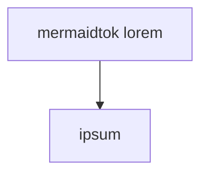
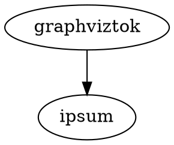
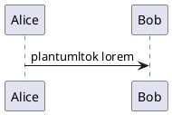

# Keyboard text selection

Plain lorem paratoken ipsum dolor.

## Heading lorem headtoken ipsum

> Quote lorem quotetoken ipsum

Before rule lorem crossrule ipsum.

---

Afterrule lorem ipsum.

Bold lorem **boldtoken words** ipsum.

Italic lorem *italictok words* ipsum.

Strike lorem ~~striketok words~~ ipsum.

Code lorem `inlinecodetok words` ipsum.

Link lorem [linktexttok words](https://example.com) ipsum.

Wiki lorem [[Wikipagetok Name]] ipsum.

Footnote lorem reference[^fnlabeltok] ipsum.

Emoji lorem :heart: emojitailtok ipsum.

Math lorem $mathinlinetok + 1$ ipsum.

Html lorem <kbd>kbdtoken words</kbd> ipsum.

- unordered lorem ultoken ipsum
- second item

1. ordered lorem oltoken ipsum
2. second item

- [ ] task lorem tasktoken ipsum
- [x] done item

- outer item
  - inner lorem nestedtok ipsum

Before table lorem crosstable ipsum.

| Crosshead one | Head headcelltok two | Head three |
| --- | --- | --- |
| lorem ipsum | dolor sit | amet elit |
| lorem left | startcelltok lorem centercell endcelltok | lorem right |
| lorem ipsum | dolor sit | amet elit |

| Multi one | Multi two | Multi three |
| --- | --- | --- |
| lorem ipsum | dolor sit | amet elit |
| lorem left | lorem cellfirsttok ipsum<br>dolor celllasttok amet | lorem right |
| lorem ipsum | dolor sit | amet elit |

| Left | Center | Right |
| :--- | :---: | ---: |
| lorem | lorem alignedtok ipsum | lorem |
| lorem | dolor | lorem |

- list item before table

  | Item one | Item two |
  | --- | --- |
  | lorem listcelltok ipsum | dolor |

> | Quote one | Quote two |
> | --- | --- |
> | lorem quotecelltok ipsum | dolor |

> [!NOTE]
> Callout lorem callouttok ipsum
>
> | Note one | Note two |
> | --- | --- |
> | lorem calloutcelltok ipsum | dolor |

<details>
<summary>Summary lorem summarytok ipsum</summary>

Body lorem detailsbodytok ipsum.

| Detail one | Detail two |
| --- | --- |
| lorem detailcelltok ipsum | dolor |

</details>

Before list lorem crosslist ipsum.

- crossitem lorem ipsum

Before code lorem crosscode ipsum.

```js
const crosscodeline = 'fencedtok ipsum'
```

Indented code follows.

    indented lorem indentok ipsum



```echarts
{
  "title": { "text": "echartstok lorem" },
  "xAxis": { "type": "category", "data": ["a"] },
  "yAxis": { "type": "value" },
  "series": [{ "type": "bar", "data": [1] }]
}
```

```mindmap
- mindmaptok lorem
  - ipsum
```

```flowchart
st=>start: flowtok lorem
e=>end: ipsum
st->e
```





```markmap
# markmaptok lorem
## ipsum
```

```abc
X:1
T:abctoken lorem
K:C
CDEF|
```

```smiles
CCCCCCCCCO
```

```math
mathblocktok + lorem
```

$$
dollarmathtok + ipsum
$$

```wavedrom
{ signal: [{ name: "wavedromtok", wave: "01.0" }] }
```

```nomnoml
[nomnomltok lorem] -> [ipsum]
```

```geojson
{
  "type": "Feature",
  "properties": { "name": "geojsontok lorem" },
  "geometry": { "type": "Point", "coordinates": [0, 0] }
}
```

```topojson
{
  "type": "Topology",
  "arcs": [],
  "objects": { "topojsontok": { "type": "GeometryCollection", "geometries": [] } }
}
```

```vega
{
  "$schema": "https://vega.github.io/schema/vega/v5.json",
  "description": "vegatoken lorem",
  "width": 40,
  "height": 40
}
```

```vega-lite
{
  "description": "vegalitetok lorem",
  "data": { "values": [{ "a": 1 }] },
  "mark": "bar",
  "encoding": { "x": { "field": "a", "type": "quantitative" } }
}
```

```stl
solid stltoken lorem
 facet normal 0 0 1
  outer loop
   vertex 0 0 0
   vertex 1 0 0
   vertex 0 1 0
  endloop
 endfacet
endsolid cube
```

```d2
d2token lorem -> ipsum
```

<div class="note">
htmlblocktok lorem ipsum
</div>

Final lorem paragraph.

[^fnlabeltok]: Footnote lorem footdeftok ipsum.
