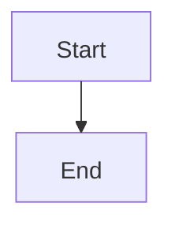
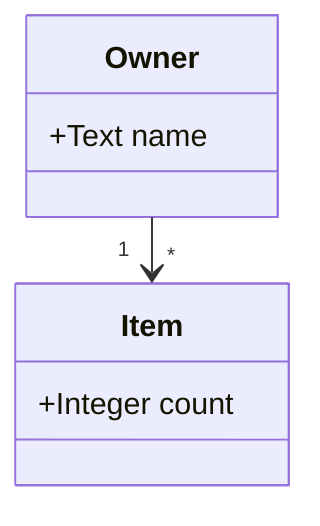
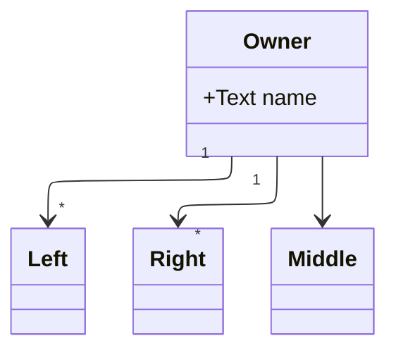
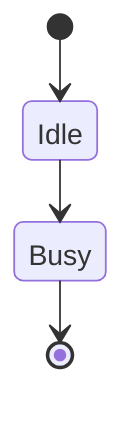

# Mermaid report fixture

Synthetic content for Task 705. Every diagram asks for the ELK layout.

## Flowchart



## Class diagram, straight edge with cardinalities



## Class diagram, fan-out



## State diagram



## Broken block

```mermaid
this is not a mermaid diagram
```
