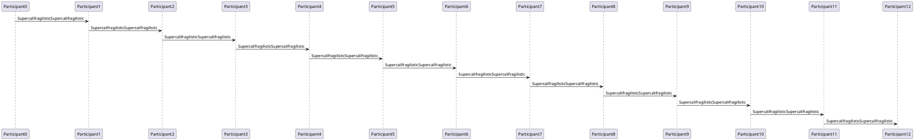

# Preview overflow stress fixture

<!-- Task 713. Each construct follows a level-2 heading "C:<construct>"; the spec groups the rendered top-level blocks by the nearest preceding marker heading. The front matter above is the "front-matter" construct. -->

[toc]

## C:heading-long-word

### SupercalifragilisticSupercalifragilisticSupercalifragilisticSupercalifragilisticSupercalifragilisticSupercalifragilisticSupercalifragilisticSupercalifragilisticSupercalifragilistic

## C:paragraph-long-url

See https://example.com/very-long-path-segment-without-any-spacesvery-long-path-segment-without-any-spacesvery-long-path-segment-without-any-spacesvery-long-path-segment-without-any-spacesvery-long-path-segment-without-any-spaces/end for details.

## C:paragraph-long-word

Word SupercalifragilisticSupercalifragilisticSupercalifragilisticSupercalifragilisticSupercalifragilisticSupercalifragilisticSupercalifragilisticSupercalifragilisticSupercalifragilistic ends.

## C:paragraph-long-inline-code

Call `DisableInjectingBootstrapOverrideAttributeDisableInjectingBootstrapOverrideAttributeDisableInjectingBootstrapOverrideAttributeDisableInjectingBootstrapOverrideAttribute` now.

## C:blockquote

> Quote with SupercalifragilisticSupercalifragilisticSupercalifragilisticSupercalifragilisticSupercalifragilisticSupercalifragilisticSupercalifragilisticSupercalifragilisticSupercalifragilistic and `DisableInjectingBootstrapOverrideAttributeDisableInjectingBootstrapOverrideAttributeDisableInjectingBootstrapOverrideAttributeDisableInjectingBootstrapOverrideAttribute` inside.
>
> > Nested quote https://example.com/very-long-path-segment-without-any-spacesvery-long-path-segment-without-any-spacesvery-long-path-segment-without-any-spacesvery-long-path-segment-without-any-spacesvery-long-path-segment-without-any-spaces/end

## C:hr

---

## C:nested-lists

- level one SupercalifragilisticSupercalifragilisticSupercalifragilisticSupercalifragilisticSupercalifragilisticSupercalifragilisticSupercalifragilisticSupercalifragilisticSupercalifragilistic
  1. level two `DisableInjectingBootstrapOverrideAttributeDisableInjectingBootstrapOverrideAttributeDisableInjectingBootstrapOverrideAttributeDisableInjectingBootstrapOverrideAttribute`
     - level three https://example.com/very-long-path-segment-without-any-spacesvery-long-path-segment-without-any-spacesvery-long-path-segment-without-any-spacesvery-long-path-segment-without-any-spacesvery-long-path-segment-without-any-spaces/end
       - level four SupercalifragilisticSupercalifragilisticSupercalifragilisticSupercalifragilisticSupercalifragilisticSupercalifragilisticSupercalifragilisticSupercalifragilisticSupercalifragilistic

## C:task-list

- [ ] open task SupercalifragilisticSupercalifragilisticSupercalifragilisticSupercalifragilisticSupercalifragilisticSupercalifragilisticSupercalifragilisticSupercalifragilisticSupercalifragilistic
- [x] done task `DisableInjectingBootstrapOverrideAttributeDisableInjectingBootstrapOverrideAttributeDisableInjectingBootstrapOverrideAttributeDisableInjectingBootstrapOverrideAttribute`

## C:deep-nesting

- depth 0 SupercalifragilisticSupercalifragilistic
  - depth 1 SupercalifragilisticSupercalifragilistic
    - depth 2 SupercalifragilisticSupercalifragilistic
      - depth 3 SupercalifragilisticSupercalifragilistic
        - depth 4 SupercalifragilisticSupercalifragilistic
          - depth 5 SupercalifragilisticSupercalifragilistic
            - depth 6 SupercalifragilisticSupercalifragilistic
              - depth 7 SupercalifragilisticSupercalifragilistic
                - depth 8 SupercalifragilisticSupercalifragilistic
                  - depth 9 SupercalifragilisticSupercalifragilistic
                    - deepest SupercalifragilisticSupercalifragilisticSupercalifragilisticSupercalifragilisticSupercalifragilisticSupercalifragilisticSupercalifragilisticSupercalifragilisticSupercalifragilistic

## C:table-wide

| Column 0 SupercalifragilisticSupercalif | Column 1 SupercalifragilisticSupercalif | Column 2 SupercalifragilisticSupercalif | Column 3 SupercalifragilisticSupercalif | Column 4 SupercalifragilisticSupercalif | Column 5 SupercalifragilisticSupercalif | Column 6 SupercalifragilisticSupercalif | Column 7 SupercalifragilisticSupercalif |
|---|---|---|---|---|---|---|---|
| cell0SupercalifragilisticSupercalifragilistic | cell1SupercalifragilisticSupercalifragilistic | cell2SupercalifragilisticSupercalifragilistic | cell3SupercalifragilisticSupercalifragilistic | cell4SupercalifragilisticSupercalifragilistic | cell5SupercalifragilisticSupercalifragilistic | cell6SupercalifragilisticSupercalifragilistic | cell7SupercalifragilisticSupercalifragilistic |

## C:table-code-url-aligned

| Current | Meaning | Candidate |
|:---|:---:|---:|
| `DisableServiceBootstrapOverrideAttribute` | Turns off bootstrap override | `DisableInjectingBootstrapOverrideAttribute` |
| https://example.com/very-long-path-segment-without-any-spacesvery-long-path-segment-without-any-spacesvery-long-path-segment-without-any-spacesvery-long-path-segment-without-any-spacesvery-long-path-segment-without-any-spaces/end | SupercalifragilisticSupercalifragilisticSupercalifragilisticSupercalifragilisticSupercalif | `DisableInjectingBootstrapOverrideAttributeDisableInjectingBootstrapOverrideAttri` |

## C:table-in-list

- list item

  | Current | Meaning | Candidate |
  |:---|:---:|---:|
  | `DisableServiceBootstrapOverrideAttribute` | Turns off bootstrap override | `DisableInjectingBootstrapOverrideAttribute` |
  | https://example.com/very-long-path-segment-without-any-spacesvery-long-path-segment-without-any-spacesvery-long-path-segment-without-any-spacesvery-long-path-segment-without-any-spacesvery-long-path-segment-without-any-spaces/end | SupercalifragilisticSupercalifragilisticSupercalifragilisticSupercalifragilisticSupercalif | `DisableInjectingBootstrapOverrideAttributeDisableInjectingBootstrapOverrideAttri` |

## C:table-in-blockquote

> | Current | Meaning | Candidate |
> |:---|:---:|---:|
> | `DisableServiceBootstrapOverrideAttribute` | Turns off bootstrap override | `DisableInjectingBootstrapOverrideAttribute` |
> | https://example.com/very-long-path-segment-without-any-spacesvery-long-path-segment-without-any-spacesvery-long-path-segment-without-any-spacesvery-long-path-segment-without-any-spacesvery-long-path-segment-without-any-spaces/end | SupercalifragilisticSupercalifragilisticSupercalifragilisticSupercalifragilisticSupercalif | `DisableInjectingBootstrapOverrideAttributeDisableInjectingBootstrapOverrideAttri` |

## C:table-in-callout

> [!NOTE]
> | Current | Meaning | Candidate |
> |:---|:---:|---:|
> | `DisableServiceBootstrapOverrideAttribute` | Turns off bootstrap override | `DisableInjectingBootstrapOverrideAttribute` |
> | https://example.com/very-long-path-segment-without-any-spacesvery-long-path-segment-without-any-spacesvery-long-path-segment-without-any-spacesvery-long-path-segment-without-any-spacesvery-long-path-segment-without-any-spaces/end | SupercalifragilisticSupercalifragilisticSupercalifragilisticSupercalifragilisticSupercalif | `DisableInjectingBootstrapOverrideAttributeDisableInjectingBootstrapOverrideAttri` |

## C:table-in-details

<details open>
<summary>Details with table</summary>

| Current | Meaning | Candidate |
|:---|:---:|---:|
| `DisableServiceBootstrapOverrideAttribute` | Turns off bootstrap override | `DisableInjectingBootstrapOverrideAttribute` |
| https://example.com/very-long-path-segment-without-any-spacesvery-long-path-segment-without-any-spacesvery-long-path-segment-without-any-spacesvery-long-path-segment-without-any-spacesvery-long-path-segment-without-any-spaces/end | SupercalifragilisticSupercalifragilisticSupercalifragilisticSupercalifragilisticSupercalif | `DisableInjectingBootstrapOverrideAttributeDisableInjectingBootstrapOverrideAttri` |

</details>

## C:code-fence-long-line

```js
const value = "SupercalifragilisticSupercalifragilisticSupercalifragilisticSupercalifragilisticSupercalifragilisticSupercalifragilisticSupercalifragilisticSupercalifragilisticSupercalifragilistic"; // https://example.com/very-long-path-segment-without-any-spacesvery-long-path-segment-without-any-spacesvery-long-path-segment-without-any-spacesvery-long-path-segment-without-any-spacesvery-long-path-segment-without-any-spaces/end
```

## C:code-indented

    indented_code_line_SupercalifragilisticSupercalifragilisticSupercalifragilisticSupercalifragilisticSupercalifragilisticSupercalifragilisticSupercalifragilisticSupercalifragilisticSupercalifragilistic_DisableInjectingBootstrapOverrideAttributeDisableInjectingBootstrapOverrideAttributeDisableInjectingBootstrapOverrideAttributeDisableInjectingBootstrapOverrideAttribute

## C:math-inline

Inline $x_{0}^{2} + x_{1}^{2} + x_{2}^{2} + x_{3}^{2} + x_{4}^{2} + x_{5}^{2} + x_{6}^{2} + x_{7}^{2} + x_{8}^{2} + x_{9}^{2} + x_{10}^{2} + x_{11}^{2} + x_{12}^{2} + x_{13}^{2} + x_{14}^{2} + x_{15}^{2} + x_{16}^{2} + x_{17}^{2} + x_{18}^{2} + x_{19}^{2} + x_{20}^{2} + x_{21}^{2} + x_{22}^{2} + x_{23}^{2} + x_{24}^{2} + x_{25}^{2} + x_{26}^{2} + x_{27}^{2} + x_{28}^{2} + x_{29}^{2} + x_{30}^{2} + x_{31}^{2} + x_{32}^{2} + x_{33}^{2} + x_{34}^{2} + x_{35}^{2} + x_{36}^{2} + x_{37}^{2} + x_{38}^{2} + x_{39}^{2} + x_{40}^{2} + x_{41}^{2} + x_{42}^{2} + x_{43}^{2} + x_{44}^{2} + x_{45}^{2} + x_{46}^{2} + x_{47}^{2} + x_{48}^{2} + x_{49}^{2} + x_{50}^{2} + x_{51}^{2} + x_{52}^{2} + x_{53}^{2} + x_{54}^{2} + x_{55}^{2} + x_{56}^{2} + x_{57}^{2} + x_{58}^{2} + x_{59}^{2}$ math.

## C:math-block

$$
\frac{a_{0}}{b_{0}} + \frac{a_{1}}{b_{1}} + \frac{a_{2}}{b_{2}} + \frac{a_{3}}{b_{3}} + \frac{a_{4}}{b_{4}} + \frac{a_{5}}{b_{5}} + \frac{a_{6}}{b_{6}} + \frac{a_{7}}{b_{7}} + \frac{a_{8}}{b_{8}} + \frac{a_{9}}{b_{9}} + \frac{a_{10}}{b_{10}} + \frac{a_{11}}{b_{11}} + \frac{a_{12}}{b_{12}} + \frac{a_{13}}{b_{13}} + \frac{a_{14}}{b_{14}} + \frac{a_{15}}{b_{15}} + \frac{a_{16}}{b_{16}} + \frac{a_{17}}{b_{17}} + \frac{a_{18}}{b_{18}} + \frac{a_{19}}{b_{19}} + \frac{a_{20}}{b_{20}} + \frac{a_{21}}{b_{21}} + \frac{a_{22}}{b_{22}} + \frac{a_{23}}{b_{23}} + \frac{a_{24}}{b_{24}} + \frac{a_{25}}{b_{25}} + \frac{a_{26}}{b_{26}} + \frac{a_{27}}{b_{27}} + \frac{a_{28}}{b_{28}} + \frac{a_{29}}{b_{29}} + \frac{a_{30}}{b_{30}} + \frac{a_{31}}{b_{31}} + \frac{a_{32}}{b_{32}} + \frac{a_{33}}{b_{33}} + \frac{a_{34}}{b_{34}} + \frac{a_{35}}{b_{35}} + \frac{a_{36}}{b_{36}} + \frac{a_{37}}{b_{37}} + \frac{a_{38}}{b_{38}} + \frac{a_{39}}{b_{39}} + \frac{a_{40}}{b_{40}} + \frac{a_{41}}{b_{41}} + \frac{a_{42}}{b_{42}} + \frac{a_{43}}{b_{43}} + \frac{a_{44}}{b_{44}} + \frac{a_{45}}{b_{45}} + \frac{a_{46}}{b_{46}} + \frac{a_{47}}{b_{47}} + \frac{a_{48}}{b_{48}} + \frac{a_{49}}{b_{49}}
$$

## C:mermaid


## C:flowchart

```flowchart
op0=>operation: SupercalifragilisticSupercalif0
op1=>operation: SupercalifragilisticSupercalif1
op2=>operation: SupercalifragilisticSupercalif2
op3=>operation: SupercalifragilisticSupercalif3
op4=>operation: SupercalifragilisticSupercalif4
op5=>operation: SupercalifragilisticSupercalif5
op6=>operation: SupercalifragilisticSupercalif6
op7=>operation: SupercalifragilisticSupercalif7
op0(right)->op1(right)->op2(right)->op3(right)->op4(right)->op5(right)->op6(right)->op7
```

## C:mindmap

```mindmap
- SupercalifragilisticSupercalifragilisticSupercalifragilistic
  - SupercalifragilisticSupercalifragilisticSupercalif0
    - SupercalifragilisticSupercalifragilisticSupercalifx0
  - SupercalifragilisticSupercalifragilisticSupercalif1
    - SupercalifragilisticSupercalifragilisticSupercalifx1
  - SupercalifragilisticSupercalifragilisticSupercalif2
    - SupercalifragilisticSupercalifragilisticSupercalifx2
  - SupercalifragilisticSupercalifragilisticSupercalif3
    - SupercalifragilisticSupercalifragilisticSupercalifx3
```

## C:markmap

```markmap
# SupercalifragilisticSupercalifragilisticSupercalifragilistic
## SupercalifragilisticSupercalifragilisticSupercalifragilistic0
- SupercalifragilisticSupercalifragilisticSupercalifragilisticleaf0
## SupercalifragilisticSupercalifragilisticSupercalifragilistic1
- SupercalifragilisticSupercalifragilisticSupercalifragilisticleaf1
## SupercalifragilisticSupercalifragilisticSupercalifragilistic2
- SupercalifragilisticSupercalifragilisticSupercalifragilisticleaf2
## SupercalifragilisticSupercalifragilisticSupercalifragilistic3
- SupercalifragilisticSupercalifragilisticSupercalifragilisticleaf3
```

## C:plantuml



## C:d2

```d2
direction: right
node0Supercalifragil -> node1Supercalifragil -> node2Supercalifragil -> node3Supercalifragil -> node4Supercalifragil -> node5Supercalifragil -> node6Supercalifragil -> node7Supercalifragil -> node8Supercalifragil -> node9Supercalifragil -> node10Supercalifragil -> node11Supercalifragil -> node12Supercalifragil -> node13Supercalifragil
```

## C:graphviz

```graphviz
digraph G {
  rankdir=LR;
  "Supercalifragilistic0" -> "Supercalifragilistic1" -> "Supercalifragilistic2" -> "Supercalifragilistic3" -> "Supercalifragilistic4" -> "Supercalifragilistic5" -> "Supercalifragilistic6" -> "Supercalifragilistic7" -> "Supercalifragilistic8" -> "Supercalifragilistic9" -> "Supercalifragilistic10" -> "Supercalifragilistic11" -> "Supercalifragilistic12" -> "Supercalifragilistic13";
}
```



## C:nomnoml

```nomnoml
#direction: right
[Supercalifragilistic0] -> [Supercalifragilistic1] -> [Supercalifragilistic2] -> [Supercalifragilistic3] -> [Supercalifragilistic4] -> [Supercalifragilistic5] -> [Supercalifragilistic6] -> [Supercalifragilistic7] -> [Supercalifragilistic8] -> [Supercalifragilistic9] -> [Supercalifragilistic10] -> [Supercalifragilistic11]
```

## C:wavedrom

```wavedrom
{ "signal": [{ "name": "clk", "wave": "p........................................................................................................................" }, { "name": "dat", "wave": "x345x345x345x345x345x345x345x345x345x345x345x345x345x345x345x345x345x345x345x345x345x345x345x345x345x345x345x345x345x345x" }] }
```

## C:echarts

```echarts
{ "grid": {"width": 2000}, "xAxis": {"type": "category", "data": ["c0","c1","c2","c3","c4","c5","c6","c7","c8","c9","c10","c11","c12","c13","c14","c15","c16","c17","c18","c19","c20","c21","c22","c23","c24","c25","c26","c27","c28","c29","c30","c31","c32","c33","c34","c35","c36","c37","c38","c39"]}, "yAxis": {"type": "value"}, "series": [{"type": "bar", "data": [0,1,2,3,4,5,6,7,8,9,10,11,12,13,14,15,16,17,18,19,20,21,22,23,24,25,26,27,28,29,30,31,32,33,34,35,36,37,38,39]}] }
```

## C:vega

```vega
{
  "$schema": "https://vega.github.io/schema/vega/v5.json",
  "width": 2000, "height": 120,
  "data": [{"name": "t", "values": [{"x": 1, "y": 2}, {"x": 5, "y": 7}]}],
  "scales": [{"name": "xs", "domain": {"data": "t", "field": "x"}, "range": "width"}, {"name": "ys", "domain": {"data": "t", "field": "y"}, "range": "height"}],
  "marks": [{"type": "symbol", "from": {"data": "t"}, "encode": {"enter": {"x": {"scale": "xs", "field": "x"}, "y": {"scale": "ys", "field": "y"}}}}]
}
```

## C:vega-lite

```vega-lite
{
  "$schema": "https://vega.github.io/schema/vega-lite/v5.json",
  "width": 2000, "height": 120,
  "data": {"values": [{"a":"c0","b":0},{"a":"c1","b":1},{"a":"c2","b":2},{"a":"c3","b":3},{"a":"c4","b":4},{"a":"c5","b":5},{"a":"c6","b":6},{"a":"c7","b":7},{"a":"c8","b":8},{"a":"c9","b":9},{"a":"c10","b":10},{"a":"c11","b":11},{"a":"c12","b":12},{"a":"c13","b":13},{"a":"c14","b":14},{"a":"c15","b":15},{"a":"c16","b":16},{"a":"c17","b":17},{"a":"c18","b":18},{"a":"c19","b":19},{"a":"c20","b":20},{"a":"c21","b":21},{"a":"c22","b":22},{"a":"c23","b":23},{"a":"c24","b":24},{"a":"c25","b":25},{"a":"c26","b":26},{"a":"c27","b":27},{"a":"c28","b":28},{"a":"c29","b":29}]},
  "mark": "bar",
  "encoding": {"x": {"field": "a", "type": "nominal"}, "y": {"field": "b", "type": "quantitative"}}
}
```

## C:abc

```abc
X:1
T:SupercalifragilisticSupercalifragilisticSupercalifragilistic
M:4/4
L:1/4
K:C
C D E F G A B c C D E F G A B c C D E F G A B c C D E F G A B c C D E F G A B c C D E F G A B c C D E F G A B c C D E F G A B c C D E F G A B c C D E F G A B c C D E F G A B c C D E F G A B c |
```

## C:smiles

```smiles
CCCCCCCCCCCCCCCCCCCCCCCCCCCCCCCCCCCCCCCCCCCCCCCCCCCCCCCCCCCCCCCCCCCCCCCCCCCCCCCCO
```

## C:geojson

```geojson
{"type": "FeatureCollection", "features": [{"type": "Feature", "geometry": {"type": "LineString", "coordinates": [[-170, 0], [170, 10]]}, "properties": {"name": "SupercalifragilisticSupercalifragilisticSupercalifragilisticSupercalifragilisticSupercalifragilisticSupercalifragilisticSupercalifragilisticSupercalifragilisticSupercalifragilistic"}}]}
```

## C:topojson

```topojson
{"type": "Topology", "objects": {"r": {"type": "GeometryCollection", "geometries": [{"type": "Polygon", "arcs": [[0]], "properties": {"name": "SupercalifragilisticSupercalifragilisticSupercalifragilistic"}}]}}, "arcs": [[[0, 0], [100, 0], [100, 1], [0, 1], [0, 0]]]}
```

## C:stl

```stl
solid wide
 facet normal 0 0 1
  outer loop
   vertex 0 0 0
   vertex 1 1 0
   vertex 1 0 0
  endloop
 endfacet
 facet normal 0 0 1
  outer loop
   vertex 10 0 0
   vertex 11 1 0
   vertex 11 0 0
  endloop
 endfacet
 facet normal 0 0 1
  outer loop
   vertex 20 0 0
   vertex 21 1 0
   vertex 21 0 0
  endloop
 endfacet
 facet normal 0 0 1
  outer loop
   vertex 30 0 0
   vertex 31 1 0
   vertex 31 0 0
  endloop
 endfacet
endsolid wide
```

## C:image-wide


## C:image-svg-html


## C:link-long

[SupercalifragilisticSupercalifragilisticSupercalifragilisticSupercalifragilisticSupercalifragilisticSupercalifragilisticSupercalifragilisticSupercalifragilisticSupercalifragilistic](https://example.com/very-long-path-segment-without-any-spacesvery-long-path-segment-without-any-spacesvery-long-path-segment-without-any-spacesvery-long-path-segment-without-any-spacesvery-long-path-segment-without-any-spaces/end)

## C:footnote

Text with a footnote[^long].

[^long]: Footnote body SupercalifragilisticSupercalifragilisticSupercalifragilisticSupercalifragilisticSupercalifragilisticSupercalifragilisticSupercalifragilisticSupercalifragilisticSupercalifragilistic https://example.com/very-long-path-segment-without-any-spacesvery-long-path-segment-without-any-spacesvery-long-path-segment-without-any-spacesvery-long-path-segment-without-any-spacesvery-long-path-segment-without-any-spaces/end

## C:html-block-wide

<div style="width: 2000px; background: #ddd">wide raw HTML block</div>

## C:html-inline-wide

Before <span style="display: inline-block; width: 2000px; background: #ddd">wide inline span</span> after.

## C:html-table-wide

<table><tr><td>SupercalifragilisticSupercalifragilistic0</td><td>SupercalifragilisticSupercalifragilistic1</td><td>SupercalifragilisticSupercalifragilistic2</td><td>SupercalifragilisticSupercalifragilistic3</td><td>SupercalifragilisticSupercalifragilistic4</td><td>SupercalifragilisticSupercalifragilistic5</td></tr></table>

## C:callout

> [!WARNING] SupercalifragilisticSupercalifragilisticSupercalifragilistic
> Callout body SupercalifragilisticSupercalifragilisticSupercalifragilisticSupercalifragilisticSupercalifragilisticSupercalifragilisticSupercalifragilisticSupercalifragilisticSupercalifragilistic `DisableInjectingBootstrapOverrideAttributeDisableInjectingBootstrapOverrideAttributeDisableInjectingBootstrapOverrideAttributeDisableInjectingBootstrapOverrideAttribute`

## C:details-open

<details open>
<summary>SupercalifragilisticSupercalifragilisticSupercalifragilisticSupercalifragilisticSupercalifragilisticSupercalifragilisticSupercalifragilisticSupercalifragilisticSupercalifragilistic</summary>

Open details body SupercalifragilisticSupercalifragilisticSupercalifragilisticSupercalifragilisticSupercalifragilisticSupercalifragilisticSupercalifragilisticSupercalifragilisticSupercalifragilistic `DisableInjectingBootstrapOverrideAttributeDisableInjectingBootstrapOverrideAttributeDisableInjectingBootstrapOverrideAttributeDisableInjectingBootstrapOverrideAttribute`

</details>

## C:details-closed

<details>
<summary>SupercalifragilisticSupercalifragilisticSupercalifragilisticSupercalifragilisticSupercalifragilisticSupercalifragilisticSupercalifragilisticSupercalifragilisticSupercalifragilistic</summary>

Closed details body SupercalifragilisticSupercalifragilisticSupercalifragilisticSupercalifragilisticSupercalifragilisticSupercalifragilisticSupercalifragilisticSupercalifragilisticSupercalifragilistic

</details>

## C:wiki-link

Wiki link [[SupercalifragilisticSupercalifragilisticSupercalifragilisticSupercalifragilistic]] and [[Some Page|SupercalifragilisticSupercalifragilisticSupercalifragilisticSupercalifragilisticSupercalifragilisticSupercalifragilisticSupercalifragilisticSupercalifragilisticSupercalifragilistic]].

## C:nested-combo

> [!TIP]
> - list in callout `DisableInjectingBootstrapOverrideAttributeDisableInjectingBootstrapOverrideAttributeDisableInjectingBootstrapOverrideAttributeDisableInjectingBootstrapOverrideAttribute`
>   > quote in list in callout SupercalifragilisticSupercalifragilisticSupercalifragilisticSupercalifragilisticSupercalifragilisticSupercalifragilisticSupercalifragilisticSupercalifragilisticSupercalifragilistic
>
> ```js
> const nested = "SupercalifragilisticSupercalifragilisticSupercalifragilisticSupercalifragilisticSupercalifragilisticSupercalifragilisticSupercalifragilisticSupercalifragilisticSupercalifragilistic"
> ```

## C:end

End of fixture.
